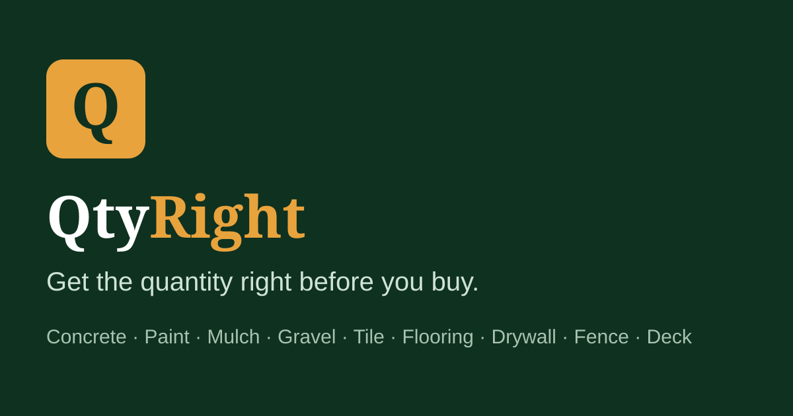

# QtyRight — Free Home Material Calculators

**Get the quantity right before you buy.**

QtyRight is a free online tools website for US homeowners and DIYers. Each
calculator answers the question people actually ask in the store aisle —
*how much do I need to buy?* — and returns whole purchasable units (bags,
gallons, sheets, boxes), an estimated cost with editable local prices, and a
printable shopping list. Where materials are sold two ways, it compares them:
**bags vs ready-mix** (concrete) and **bags vs bulk delivery** (mulch, topsoil,
gravel).



## Calculators (12)

| Tool | What it returns |
|------|-----------------|
| Concrete Calculator | Cubic yards, 40/60/80 lb bags, bags-vs-ready-mix cost |
| Paint Calculator | Gallons by room size, doors/windows, coats, ceiling option |
| Mulch Calculator | Cubic yards, bag count, bags-vs-bulk break-even |
| Gravel Calculator | Cubic yards, tons (by material density), cost |
| Tile Calculator | Tiles & boxes with pattern waste, thinset estimate |
| Flooring Calculator | Boxes of laminate / LVP / hardwood with waste |
| Drywall Calculator | Sheets (4×8 / 4×12), screws, joint compound |
| Fence Calculator | Posts, rails, pickets, post concrete, lumber cost |
| Deck Calculator | Deck boards & screws by board size and length |
| Brick Calculator | Bricks by type (from face size + mortar joint) & mortar |
| Topsoil Calculator | Cubic yards, bags, bags-vs-bulk break-even |
| Board Foot Calculator | Board feet, waste allowance, lumber cost |

Plus 3 in-depth guides, About, Contact, Privacy Policy, Terms, Disclaimer and
FAQ pages — every tool page carries unique SEO title/meta, intro content,
how-to steps, the formula, a worked example, FAQs with FAQPage schema,
WebApplication schema, breadcrumbs and related-tool internal linking.

## Why this niche?

Full research — 15 niches scored, top-3 deep-dive, competitor analysis,
keyword→page mapping and sources — is in
[docs/RESEARCH-AND-STRATEGY.md](docs/RESEARCH-AND-STRATEGY.md). Short version:
home-improvement calculators have proven US organic demand (leading competitor:
5.21M visits/mo, 58.5% US), top-tier advertiser CPCs (WordStream home-services
benchmark $8.33 in 2026), stable pure-browser maths, and long-tail SERPs where
new sites demonstrably still rank.

## Tech stack

- **Next.js 15** (App Router, TypeScript) with **static export** — no server,
  no database, no paid APIs. Deploys anywhere static files are served.
- **React 19** client components for the calculators; all maths is pure
  TypeScript in `lib/calc.ts`, unit-tested against known worked examples.
- Zero runtime dependencies beyond Next/React. No tracking or ads code loads
  unless the owner configures it (see below).

## Local development

```bash
npm install
npm run dev        # http://localhost:3000
```

## Build & test

```bash
npm run test:calcs # unit-test all 12 calculators against worked examples
npm run build      # type-checks (tsc) and exports static site to ./out
```

## Deployment

The build is a static export (`out/`). Recommended: **Vercel** (import the
repo, framework preset Next.js) or **Cloudflare Pages** (build command
`npm run build`, output directory `out`). Full step-by-step instructions —
custom domain, Search Console, sitemap submission, Analytics and the AdSense
application checklist — are in [DEPLOYMENT.md](DEPLOYMENT.md).

## Environment variables

See [.env.example](.env.example). All are public `NEXT_PUBLIC_*` identifiers
(no secrets exist in this project):

| Variable | Purpose |
|----------|---------|
| `NEXT_PUBLIC_SITE_URL` | Canonical domain used for SEO URLs, sitemap, OG |
| `NEXT_PUBLIC_CONTACT_EMAIL` | Address shown on Contact/Privacy/Terms pages |
| `NEXT_PUBLIC_ADSENSE_CLIENT_ID` | AdSense publisher ID — blank until approved |
| `NEXT_PUBLIC_AD_SLOT_HOME/TOOL/GUIDE` | Ad unit IDs for the three placements |
| `NEXT_PUBLIC_GA_MEASUREMENT_ID` | Optional Google Analytics 4 |

## AdSense readiness

Ad placements are components (`components/AdSlot.tsx`) that render **nothing**
until a real publisher ID and ad-unit IDs are configured — no fake ads, no
placeholder boxes. Slots sit after results / mid-guide, never next to inputs or
buttons (accidental-click policy). The site ships with the pages AdSense
review looks for: About, Contact, Privacy Policy, Terms, Disclaimer, original
tools and original content. Approval is Google's decision and is not guaranteed.

## Project structure

```
app/            Pages (App Router): home, [slug] tool pages, guides, info pages,
                sitemap.ts, robots.ts
components/     Calculator, ToolsGrid, AdSlot, ContactForm
lib/            calc.ts (pure maths), tools.ts (tool data/content),
                guides.ts, site.ts (env-driven config)
scripts/        test-calcs.mts (calculator unit tests), qa.mjs (export QA)
docs/           RESEARCH-AND-STRATEGY.md, TESTING-REPORT.md
```

## Licence

All rights reserved (content and brand). The code structure may be used as a
reference for your own projects.
